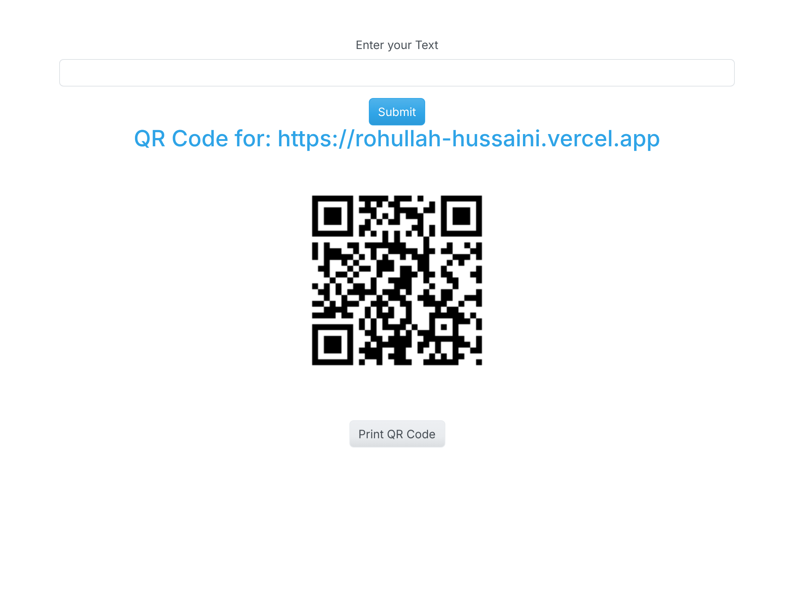
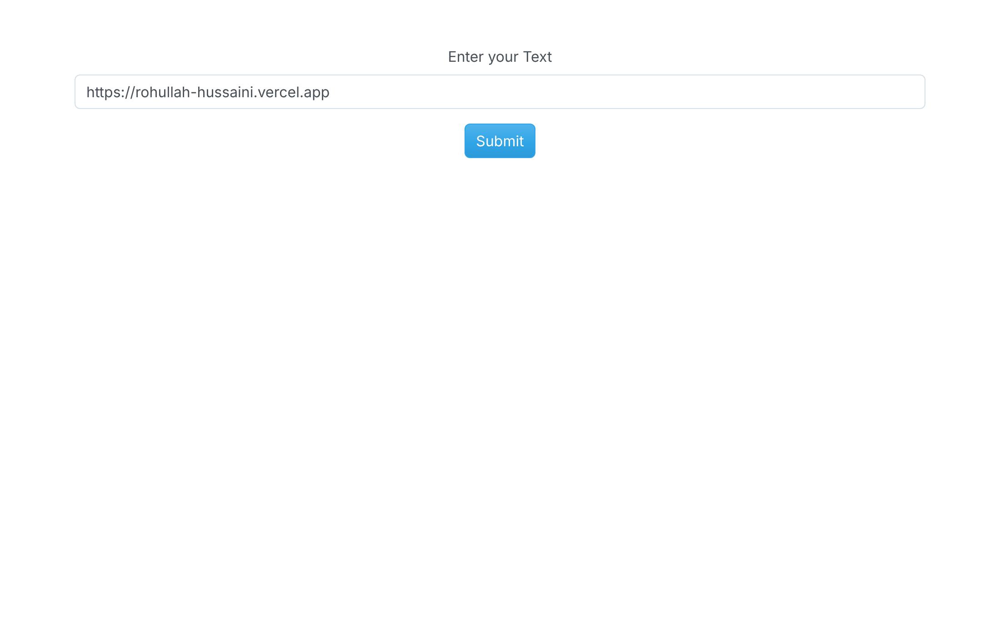
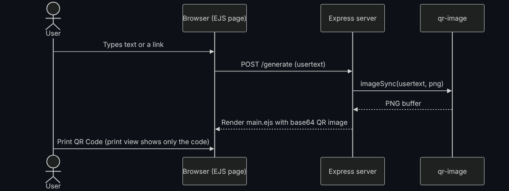

# 🔳 QR Code Generator

A small Node.js and Express web app: type any text or link, press **Submit**, and get a QR code you can scan or print.

**Live demo:** [qr-code-reader-five.vercel.app](https://qr-code-reader-five.vercel.app)



## Screenshots

| Enter your text | QR code ready to print |
|---|---|
|  |  |

## Features

- Turns any text or URL into a QR code on the server
- Shows the code right on the page as an image (no files saved)
- **Print QR Code** button with a print layout that prints only the code, large and centred
- Works on phone and desktop (Bootstrap)

## Tech stack

| Part | Used |
|---|---|
| Server | Node.js, Express 4 |
| Views | EJS templates |
| QR codes | `qr-image` |
| Styling | Bootstrap 4, custom print CSS |
| Hosting | Vercel (`@vercel/node`) |

## How it works



## Run it locally

```bash
npm install
npm start
```

Then open http://localhost:3000.

## Project structure

```
qr-code-reader/
├── index.js        # Express server: GET / shows the form, POST /generate makes the QR code
├── views/main.ejs  # the page (form, QR code, print button)
├── public/         # static files
├── vercel.json     # Vercel setup
└── docs/           # screenshots and diagram
```

## Author

**Rohullah Hussaini** · [GitHub @Rohullah1122](https://github.com/Rohullah1122) · [Portfolio](https://rohullah-hussaini.vercel.app)
